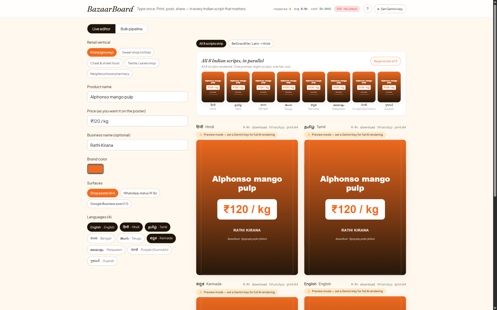
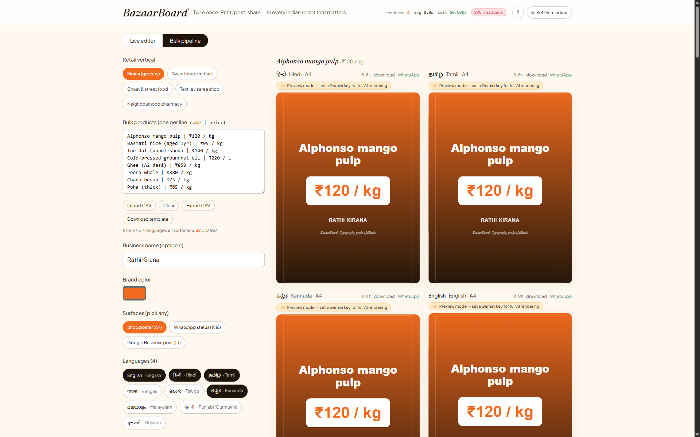

# BazaarBoard

BazaarBoard is a hackathon prototype for creating retail posters in eight Indic scripts. Enter a product and price, choose languages and output sizes, then download individual posters or a ZIP archive.

[Hosted demo](https://bazaarboard.vercel.app) ? the hosted version may differ from this repository.





## What is implemented

- Poster, WhatsApp status, and Google Business Profile layouts.
- Devanagari, Tamil, Bengali, Telugu, Kannada, Malayalam, Gurmukhi, and Gujarati output.
- A server API for Gemini image generation and an SVG fallback when no key is configured.
- A design chat, browser voice controls, and experimental sign-language features.
- Per-poster downloads and bulk export.

This project demonstrates a Next.js 16 / React 19 application with typed API handlers, input validation, fallback rendering, and automated tests. Model availability, script fidelity, generation cost, and latency depend on the selected provider and model. This repository does not establish production benchmarks or measured user adoption.

## Run locally

Use Node.js 22.13 or newer and npm.

```bash
git clone https://github.com/kaushiksaravanan/bazaarboard.git
cd bazaarboard
npm ci
cp .env.example .env.local
npm run dev
```

Open http://localhost:3000. Leave `GEMINI_API_KEY` empty to try the SVG path. To use Gemini, supply a key and select an image model available to your account with `NB2_MODEL`. The chat and gloss handlers also accept `NB2_CHAT_MODEL` and `NB2_GLOSS_MODEL` overrides. Live provider calls can incur charges.

The API-key modal stores a supplied key in the tab's `sessionStorage`. The browser sends it to the app's API handlers; those handlers forward it to Google in an API-key header. The model also receives the text needed for the requested generation. Do not put credentials in `NEXT_PUBLIC_*` variables.

## Verify

```bash
npm run lint
npm run typecheck
npm run test:run
npm run build
npm audit
```

The October 2026 maintenance check passed 960 unit and integration tests, type checking, and a production build. Lint has warnings but no errors. These checks use mocks for external services and do not verify live Gemini output or browser rendering.

`npm run e2e` uses Playwright. Its current configuration targets the hosted demo, so it is separate from the local checks above. Inspect `playwright.config.ts` before running it.

## Code map and trade-offs

- `src/app/api/generate/route.ts`: validates generation requests, calls Gemini, and provides an SVG path when no key is configured.
- `src/app/api/chat/route.ts`: handles design chat and tool responses.
- `src/lib/`: generation clients, export utilities, language support, and telemetry.
- `src/components/`: editing, voice, and poster interfaces.
- `test/`: unit and integration tests; `e2e/`: browser journeys.

An SVG fallback lets the editor work without image-generation credentials. It is a template renderer and does not provide the same output as a model. Prompt fencing is a defense in depth measure; it does not guarantee immunity to prompt injection.

The app includes Vercel Analytics and Speed Insights. Its own telemetry endpoint logs usage events on the server. It is not an offline or zero-telemetry application.

## Deployment

`vercel.json` disables automatic Git deployments. Pushing portfolio maintenance changes therefore does not update the hosted demo. To release a tested revision, deploy it manually in Vercel. To restore automatic deployment, change `git.deploymentEnabled` after reviewing the project's environment variables and intended production branch.

## License and author

MIT ? see [LICENSE](LICENSE).

Built by Kaushik Saravanan for the Google DeepMind Bangalore Hackathon 2026.
